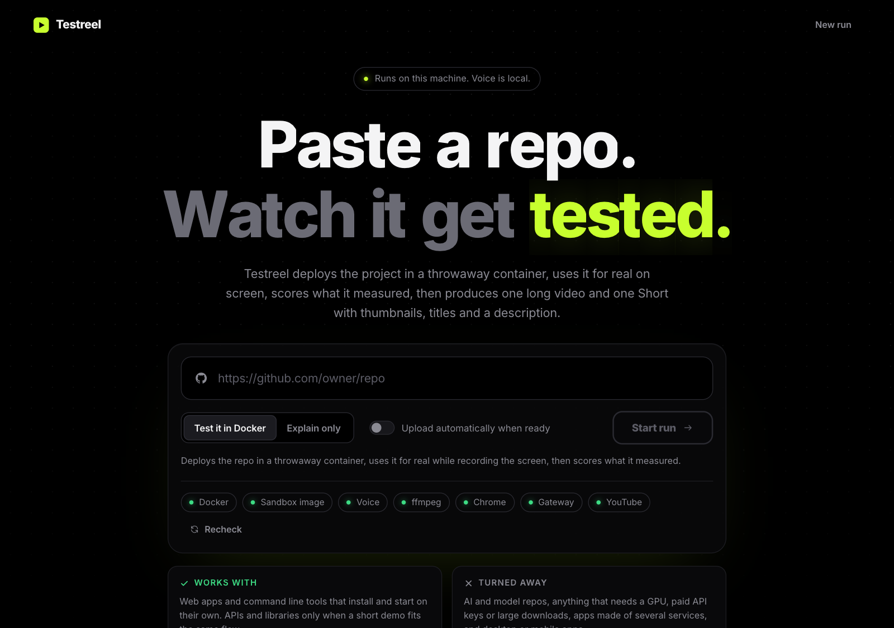
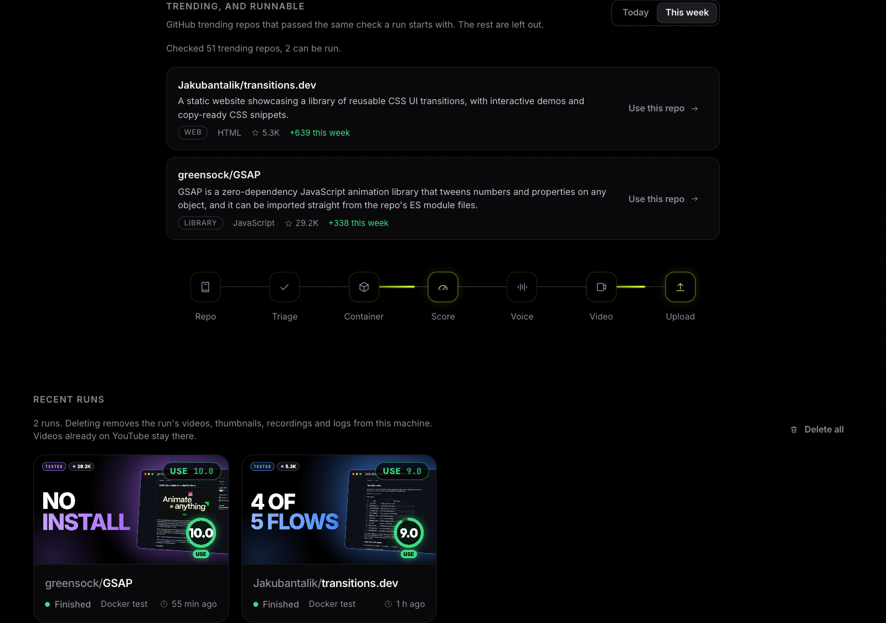
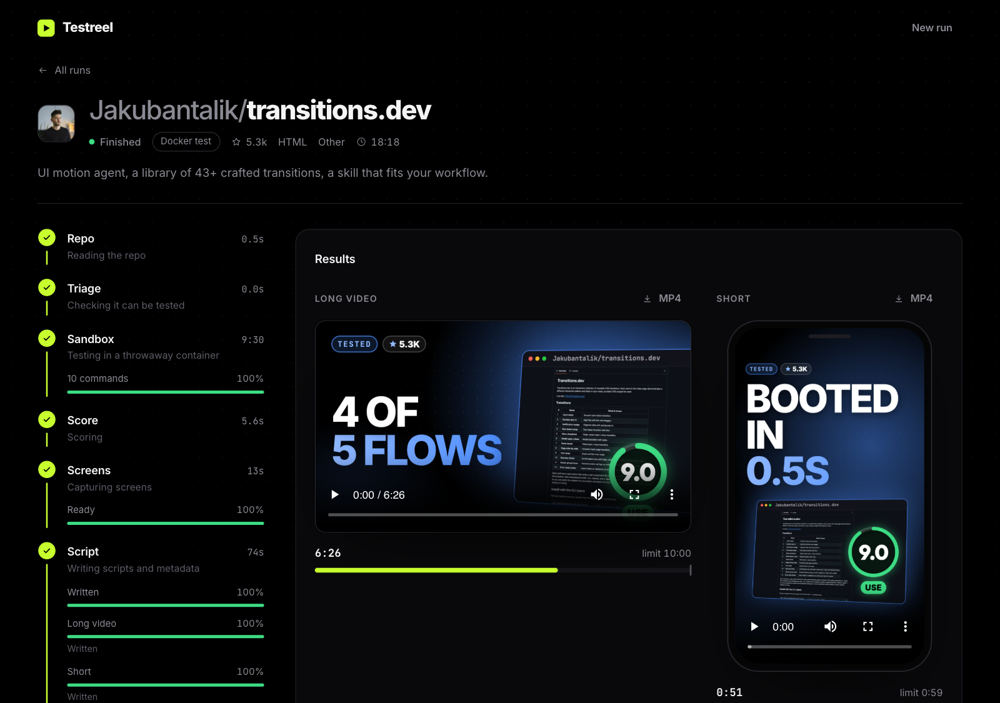
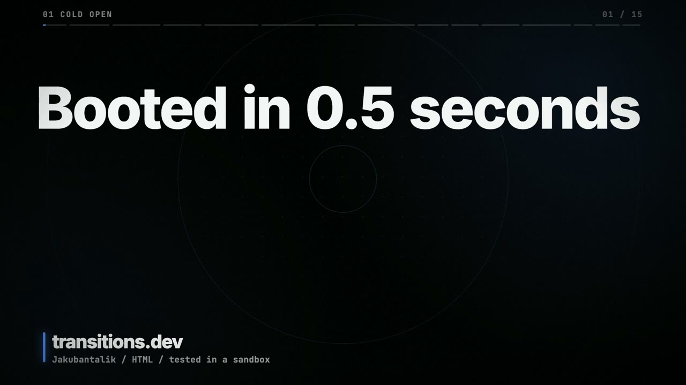
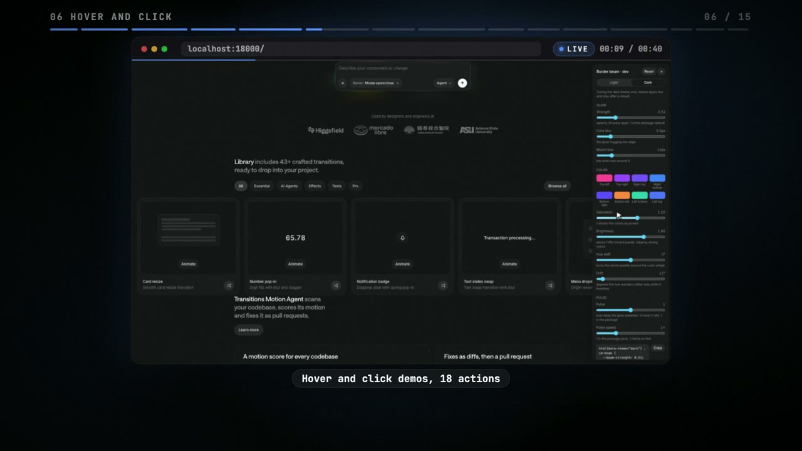
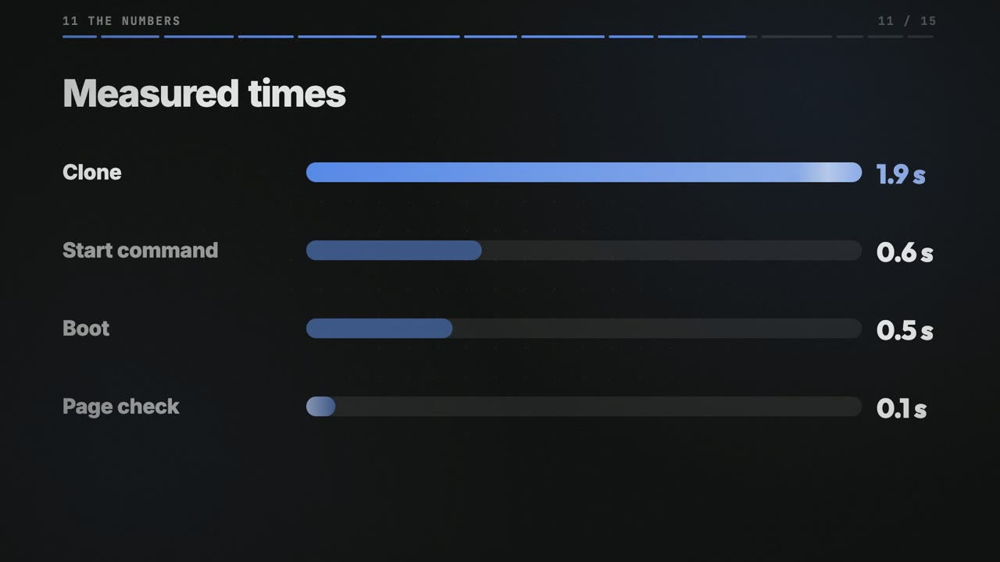
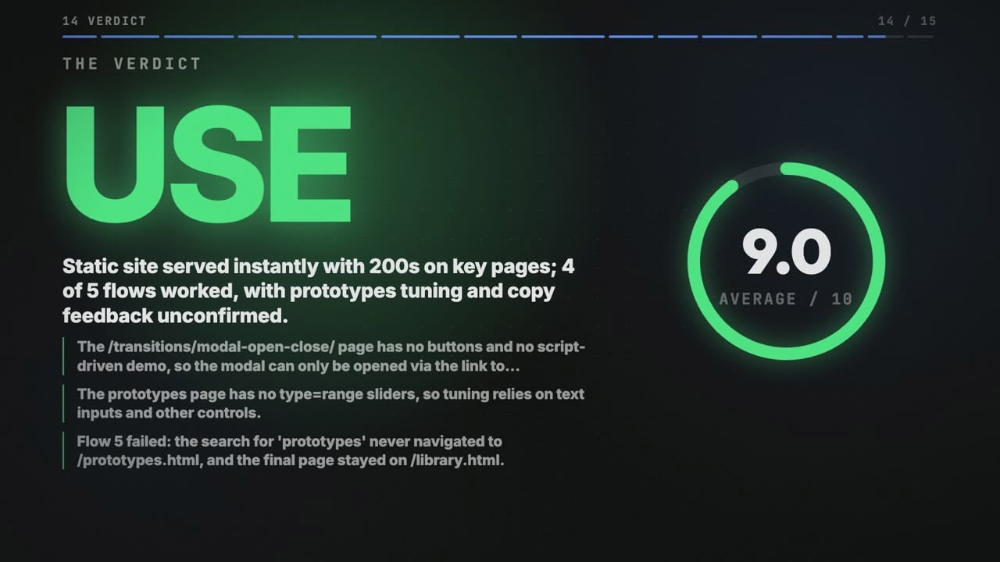
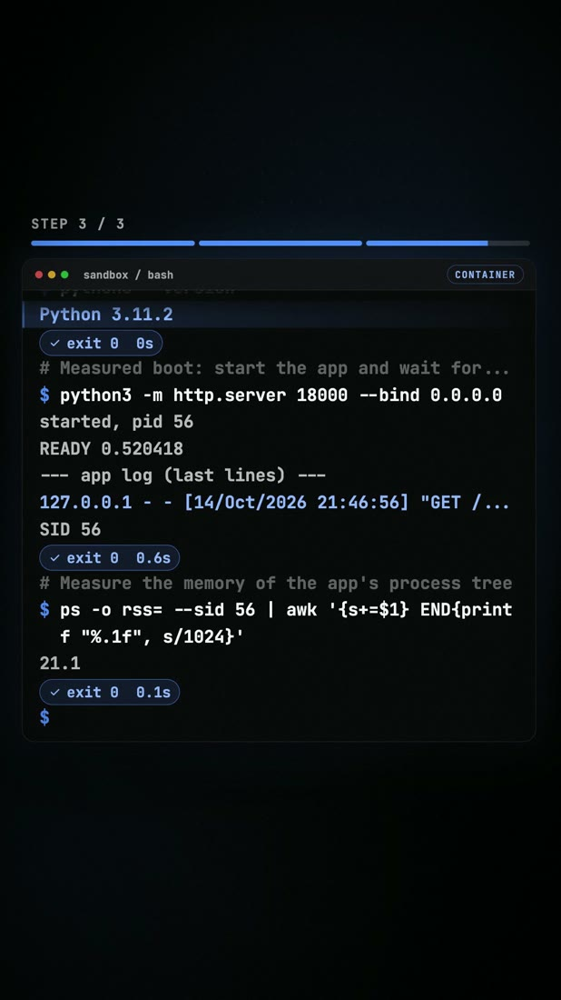
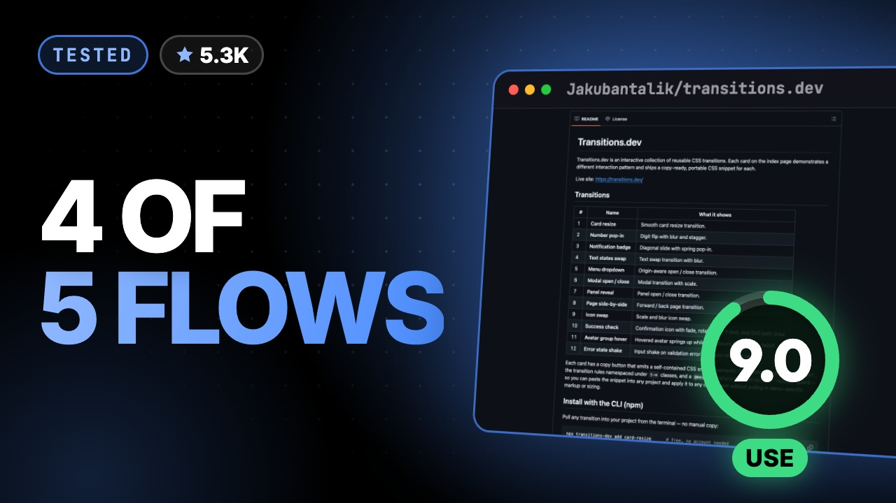

# Testreel

Paste a GitHub repo URL. Testreel installs and runs it in a throwaway Docker container, uses it for real while recording the screen, scores it from what it measured, and produces a YouTube-ready package: one long video (10 minutes at most), one Short (59 seconds at most), three thumbnails for each, title options, a description, chapters and tags. Uploading to your own channel is one click.

Everything runs on your machine. The voice is a local model. The only outside services are GitHub (to read repos), the chat model you configure, and YouTube if you choose to upload.

## Screenshots



| | |
|---|---|
|  |  |
| Trending repos that pass the same check a run starts with | A finished run: long video, Short, and every stage on the left |

What it produces, from a real run on [Jakubantalik/transitions.dev](https://github.com/Jakubantalik/transitions.dev):

| | |
|---|---|
|  |  |
| Hook, with the measured boot time | The real app, driven in a headless browser (cursor and clicks are visible) |
|  |  |
| Numbers that come from the container, not the model | Verdict and the failures the test found |

| | |
|---|---|
|  |  |
| The Short replays the real commands and output | One of three generated thumbnails |

## What makes it different

Most "AI review" tools describe a project from its README. Testreel runs it.

- The install, boot, health check, memory use, dependency audit and the repo's own tests are **measured by code** inside the container, not guessed by a model.
- A model then uses the app like a new user (a real headless Chrome for web apps, a real terminal for command line tools) and the footage in the video is that real session, with a visible cursor and click ripples.
- Scores are computed from the measurements. The model only writes the explanation, and every number it quotes is checked against the data.
- When the automated check cannot tell whether something worked, the video says so instead of calling it a bug.

## Quick start

You need Bun, Docker, ffmpeg, Chrome for Testing, Python 3.10 to 3.12 and a chat model endpoint. The full steps, with a settings reference and troubleshooting, are in [docs/setup.md](docs/setup.md). The short version, on macOS:

```sh
brew install oven-sh/bun/bun ffmpeg python@3.12     # and install Docker Desktop
git clone https://github.com/<you>/testreel.git && cd testreel
bun install
bunx puppeteer browsers install chrome
bash scripts/setup-voice.sh                         # local voice, about 350 MB
cp .env.example .env                                # then fill in GATEWAY_URL, GATEWAY_API_KEY, GATEWAY_MODEL
bun run start                                       # http://127.0.0.1:4173
```

Open the page. The chips under the form turn green as each requirement is met.

## Knowing before you run

- **Paste check.** As soon as a valid URL is pasted, Testreel runs the same triage a run starts with and says whether it can run the repo, or why not. A "no" disables Start run in test mode. The verdict is cached per repo version, so the check and the run that follows always agree.
- **Trending, and runnable.** Below the form is a list of GitHub trending repos (today or this week) that pass the check, with a "Use this repo" button. GitHub has no trending API, so this reads the public trending page and will break if GitHub changes its layout.

## What Testreel will run

It accepts ordinary apps that install and start on their own: web apps and command line tools in JavaScript or Python, and APIs or libraries when a short demo fits.

It refuses, with a plain reason: AI and machine-learning projects, anything that needs a GPU or a large model download, projects that need paid API keys, apps made of several services (compose files with databases), desktop and mobile apps, repos over 500 MB, and languages the container has no toolchain for (Go, Rust, Java and others). Refusals come first from fixed rules over the repo files, then from one model call, and the stage refuses whenever it is not clear that the repo deploys easily without keys.

## The pipeline

| Stage | What happens |
|-------|--------------|
| repo | GitHub metadata and README |
| triage | Decides if the repo can be run and writes the install, start and test commands. Commands are validated in code against an allow list |
| sandbox | Installs and starts the app in a hardened container, measures install time, boot time, health, memory, tests and a dependency audit, then drives the app and records the screen. The container, its volumes and any build cache are removed after every run |
| score | Four scores (works, quality, effort, speed) computed in code. Verdict: USE 7 and above, WATCH 5 to 7, SKIP under 5 |
| capture | Screenshots of the repo page, README and homepage |
| script | Long and short scripts, titles, description, tags and thumbnail text. A validator checks every claim against the test log |
| voice | Local Kokoro text to speech, word timings from faster-whisper, loudness normalised |
| render | Own engine: HTML scenes captured by parallel headless Chrome workers and encoded by ffmpeg, with the real screen recordings and synthesized sound design. No burned-in captions, YouTube provides its own |
| thumbnails | Three variants per video |
| package | Chapters, a disclosure line that the voice is AI generated, final metadata |

"Explain only" mode skips the sandbox and score. Its scripts never claim anything was tested.

More detail, including the scoring formulas and the sandbox limits, is in [docs/how-it-works.md](docs/how-it-works.md).

## Using the app

- **Start a run** from the home page. Only one run at a time. Cancel or retry from the run page. A failed run resumes from the stage that failed.
- **Watch it live.** The run page streams every command, its output, every metric and every screenshot as they happen.
- **Upload.** Each finished run has an Upload to YouTube card. See [docs/youtube.md](docs/youtube.md) for the one-time Google setup.
- **Clean up.** Every run card has a delete button, and Delete all removes every finished run and its files. Videos already on YouTube are not touched.

## Safety and privacy

- The server listens on `127.0.0.1` only and refuses cross-site POST requests.
- Test containers get no mounts and no secrets, drop all Linux capabilities, cannot gain privileges, and are limited to 6 GB of memory, 4 CPUs, 2 GB of `/tmp` and a disk cap. They **do** have internet access, because installs need it. Treat the sandbox as strong isolation from your files, not as a place to run code you would be afraid to run in any container.
- No credential has a default and none is written into the project folder. Keys live in `.env` (ignored by git) and the YouTube token lives in `~/.testreel/.youtube/main.json` with mode 600.
- Auto upload, when you switch it on, always uploads as private. Public is a deliberate click.
- The voice in every video is AI generated, and the upload marks the video as containing synthetic media.
- Repo content is untrusted input to the model. The triage validates commands, and the container is the actual boundary.

See [SECURITY.md](SECURITY.md) for how to report a problem.

## Limits worth knowing

- Tested on macOS with Apple Silicon. Linux is untested.
- Portrait apps, like a todo list, fill about 70% of the frame width on a 16:9 video. They stay legible but are not dramatic.
- The quality of triage, test plans and scripts depends on the model you configure.
- The trending list reads a web page, not an API.

## Development

```sh
bun run dev          # server with hot reload
bun run typecheck    # tsc --noEmit, also run in CI
```

See [CONTRIBUTING.md](CONTRIBUTING.md).

## License

MIT, see [LICENSE](LICENSE). Bundled fonts have their own licenses, listed in [THIRD_PARTY_NOTICES.md](THIRD_PARTY_NOTICES.md).
